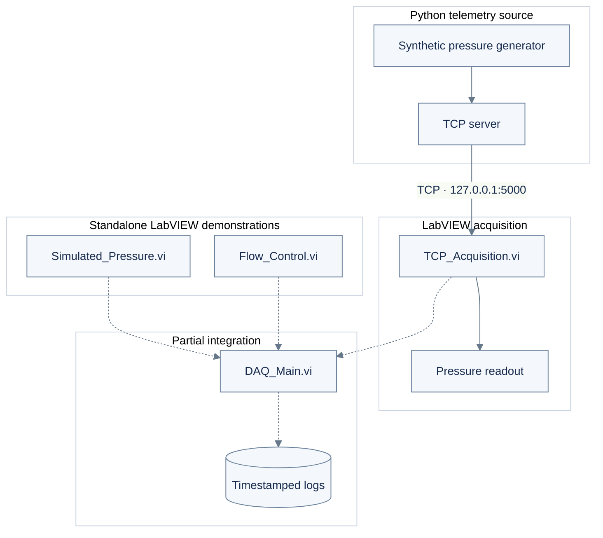
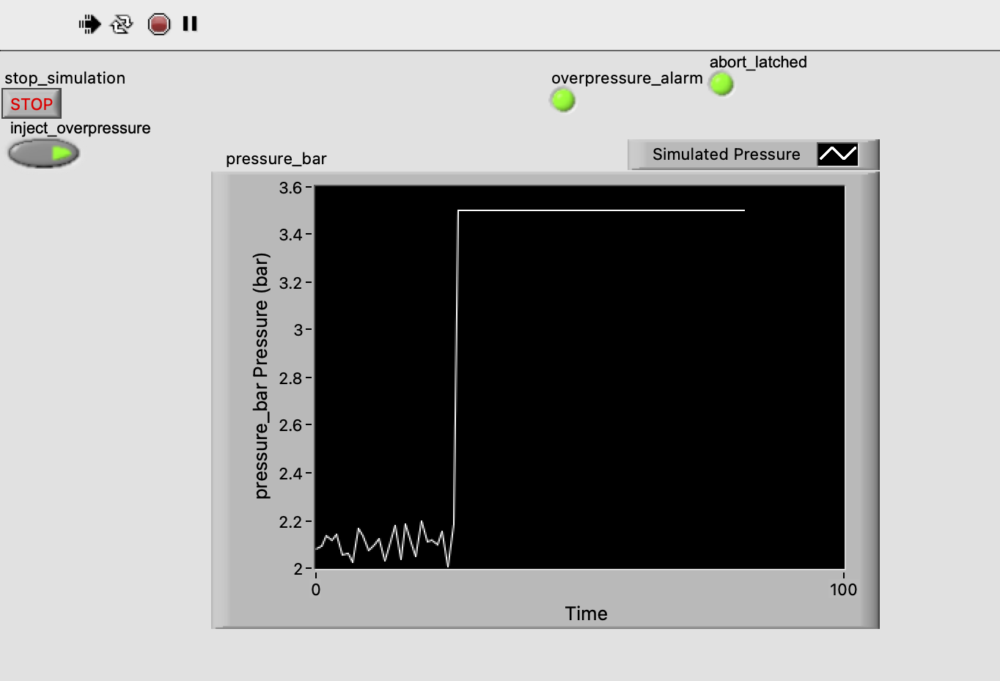
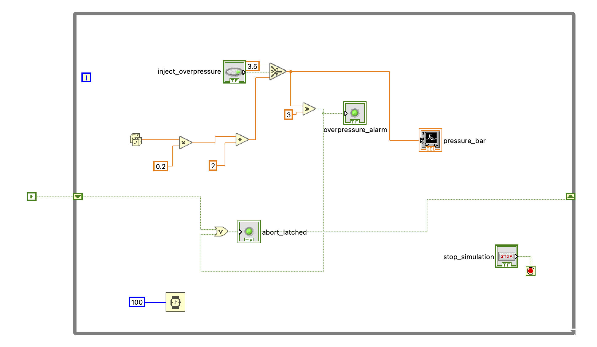
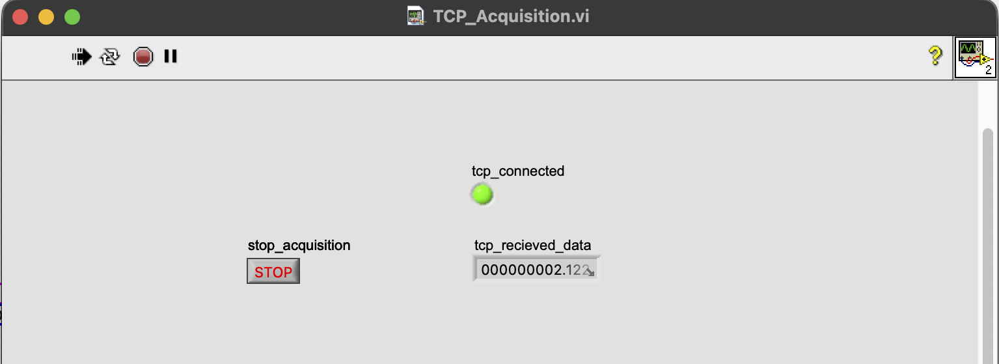
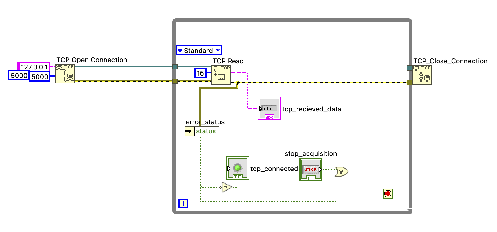
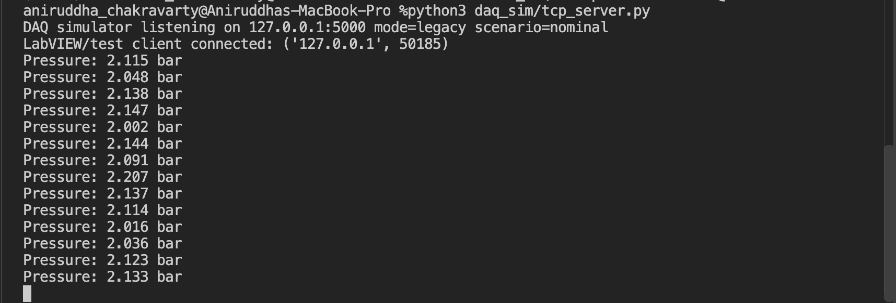
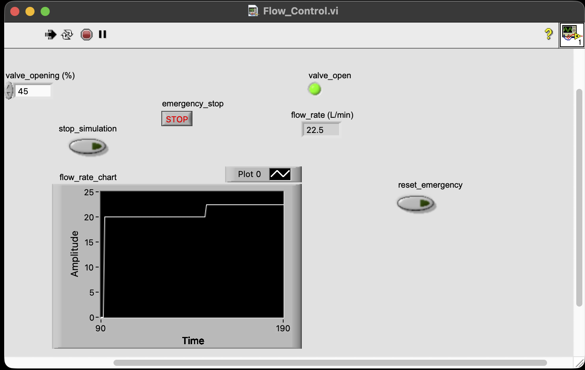
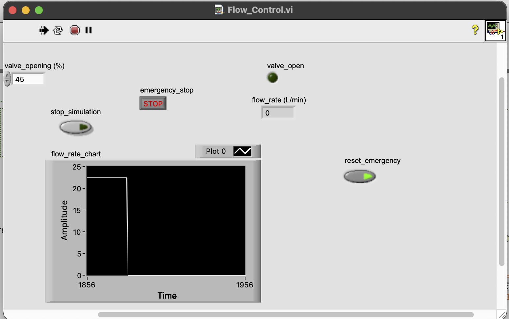
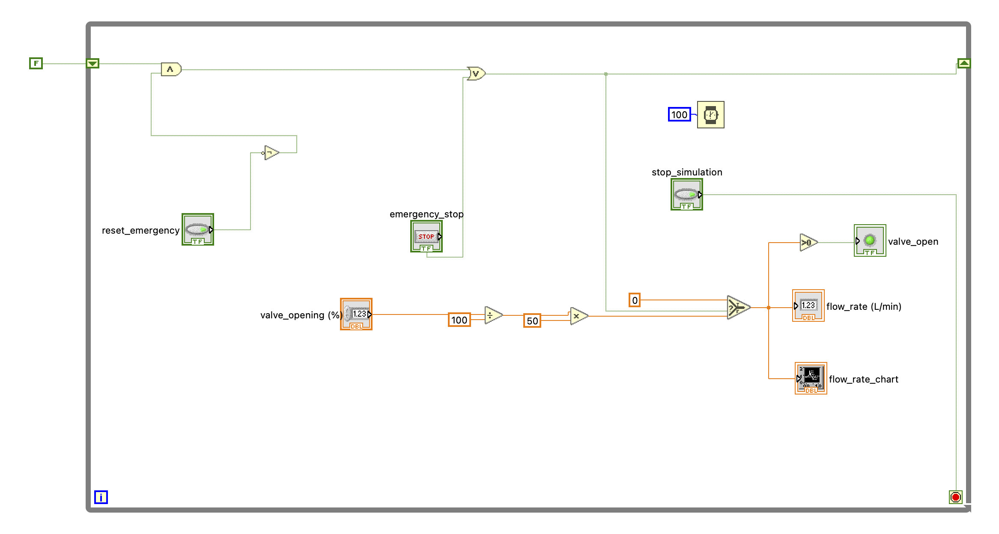
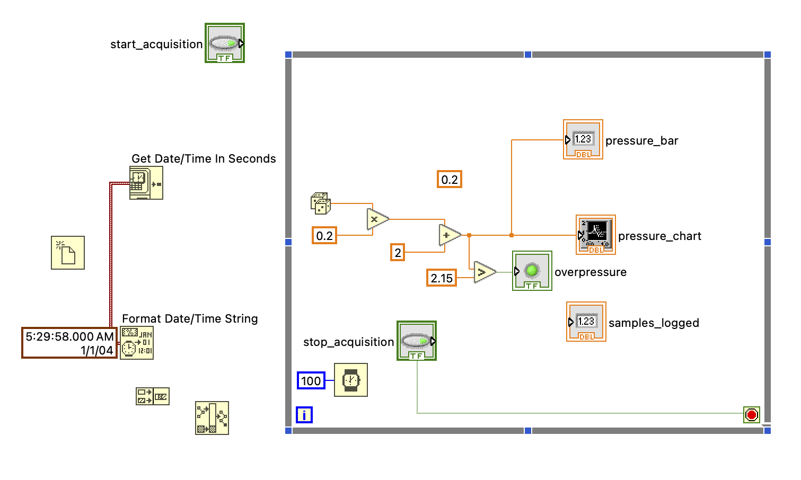

# liquid-rocket-hotfire-daq-sim

**A modular LabVIEW–Python framework for simulated liquid rocket engine ground-test data acquisition, telemetry monitoring, flow-control logic, & data logging.**

## Overview

`liquid-rocket-hotfire-daq-sim` is a software-based engineering framework exploring Data Acquisition (DAQ) and supervisory monitoring workflows for liquid rocket engine hot-fire testing.

The framework combines:

- **LabVIEW** for instrumentation interfaces, pressure visualization, TCP acquisition, simulated flow control, and data logging.
- **Python** for synthetic sensor telemetry generation and TCP communication.
- **Modular Virtual Instruments (VIs)** for acquisition, monitoring, control-state handling, and main DAQ operations.
- **Software-based validation** for nominal pressure signals, communication errors, and simulated emergency-stop conditions.

The objective is to demonstrate the fundamental architecture and engineering considerations of a ground-test DAQ system without requiring physical propulsion or instrumentation hardware.

> **Status:** Four LabVIEW VIs developed: `Simulated_Pressure.vi`, `TCP_Acquisition.vi`, `Flow_Control.vi`, and `DAQ_Main.vi`. Core simulation, TCP acquisition, and stop-control behaviors have been tested. Logging and complete system integration remain partially validated.
>
> **Scope:** ground-based static hot-fire test for liquid rocket engine. Not qualified for real propulsion-system control or hardware safety interlocks.

---

## 1. System Architecture



**Figure 1.** System-level architecture. Solid lines denote the tested TCP telemetry path; dashed lines denote unvalidated integration or logging paths. The pressure and flow-control VIs are independently operated.

## 2. Implementation Status

| Component | Demonstrated function | Status |
|:--|:--|:--|
| `daq_sim/tcp_server.py` | Synthetic pressure streaming over TCP | Implemented |
| `Simulated_Pressure.vi` | Pressure chart and threshold-based alarm | Tested |
| `TCP_Acquisition.vi` | Pressure readout and basic connection-error handling | Tested |
| `Flow_Control.vi` | Operator stop and latched emergency-stop logic | Tested |
| `DAQ_Main.vi` | Main monitoring and timestamped logging design | Partial; full logging unverified |

The demonstrated pressure signal is approximately **2.0–2.2 bar**. The Python source nominally transmits at **10 Hz**. Multichannel acquisition, synchronized test sequencing, and physical NI-DAQ hardware are outside the implemented scope.

## 3. LabVIEW Implementation Evidence

### 3.1 Simulated Pressure

Generates a local synthetic pressure waveform, displays it continuously, and evaluates an overpressure threshold.



*Figure 2. Simulated Pressure — front panel showing the pressure chart and overpressure indicator.*



*Figure 3. Simulated Pressure — LabVIEW signal generation and threshold-comparison logic.*

### 3.2 TCP Acquisition

Receives pressure samples from the Python server on `127.0.0.1:5000`. Basic error handling terminates acquisition on a communication fault.



*Figure 4. TCP Acquisition — live received-pressure display.*



*Figure 5. TCP Acquisition — connection, read loop, error handling, and cleanup.*



*Figure 6. Python telemetry server — terminal output from the acquisition test.*

### 3.3 Flow Control and Emergency Stop

Implements simulated operator-stop logic and a retained emergency-stop state during execution. No physical valves are actuated.



*Figure 7. Flow Control — operator interface under normal simulation conditions.*



*Figure 8. Flow Control — emergency-stop demonstration.*



*Figure 9. Flow Control — Boolean shutdown logic and state retention.*

### 3.4 Main DAQ Prototype

`DAQ_Main.vi` contains preliminary monitoring and file-handling logic. File creation, repeated timestamped writes, and complete integration have **not** been verified.



*Figure 10. DAQ Main — partial integration and logging block diagram.*

## 4. Acquisition Capacity Estimate

The following values are **design targets**, not measured prototype capacity.

| I/O group | Channels | Sample rate |
|:--|--:|--:|
| Slow analog inputs | 50 | 1 kHz |
| Fast analog inputs | 25 | 50 kHz |
| Digital inputs | 30 | — |
| Digital outputs | 30 | — |
| Analog outputs | 2 | — |

For 16-bit analog samples, the theoretical uncompressed throughput is

$$
R = N f_s B
$$

where $N$ is the channel count, $f_s$ is the sample rate in samples/s, and $B=2\ \mathrm{bytes/sample}$.

**Slow analog channels:**

$$
R_{\mathrm{slow}} = 50(1{,}000)(2) = 100{,}000\ \mathrm{bytes/s}
$$

**Fast analog channels:**

$$
R_{\mathrm{fast}} = 25(50{,}000)(2) = 2{,}500{,}000\ \mathrm{bytes/s}
$$

**Total raw analog throughput:**

$$
\boxed{R_{\mathrm{total}} = 2.6\ \mathrm{MB/s}}
$$

This estimate excludes metadata, timestamps, digital I/O, protocol overhead, and storage overhead. Practical deployment would require appropriate buffering, timing synchronization, and sustained-write validation.

## 5. Reproduce the Demonstration

**Requirements:** Python 3, NumPy, LabVIEW 2026 Community Edition (or compatible), and local TCP access.

From the repository root:

```bash
python3 -m venv .venv
source .venv/bin/activate
python -m pip install -r requirements.txt
python daq_sim/tcp_server.py
```

Then open `TCP_Acquisition.vi` in LabVIEW and run it with the server active. `Simulated_Pressure.vi` and `Flow_Control.vi` can be tested separately.

## 6. Validation Summary

| Test | Observation |
|:--|:--|
| Local pressure simulation | Pressure chart varies near 2.0–2.2 bar |
| TCP reception | Incoming pressure displayed in LabVIEW |
| TCP failure | Connection error observed; acquisition stops |
| Operator / emergency stop | Simulation terminates; emergency state latches during the run |
| Restart | Latched state resets on new execution |
| Timestamped logging | **Not fully verified** |
| End-to-end four-VI integration | **Not verified** |

These are manual software-level checks, not calibrated measurements or hardware acceptance tests.

## 7. Scope

The prototype does **not** implement NI-DAQmx device acquisition, deterministic control, physical valve actuation, independent safety interlocks, or a qualified hot-fire test system.


---

## 8. Conclusion

`liquid-rocket-hotfire-daq-sim` demonstrates a modular approach to LabVIEW-based data acquisition and supervisory monitoring through four Virtual Instruments and a Python telemetry source.

This framework covers synthetic pressure generation, TCP data reception, waveform visualization, communication-error handling, simulated emergency-stop logic and preliminary main DAQ logging.


---
