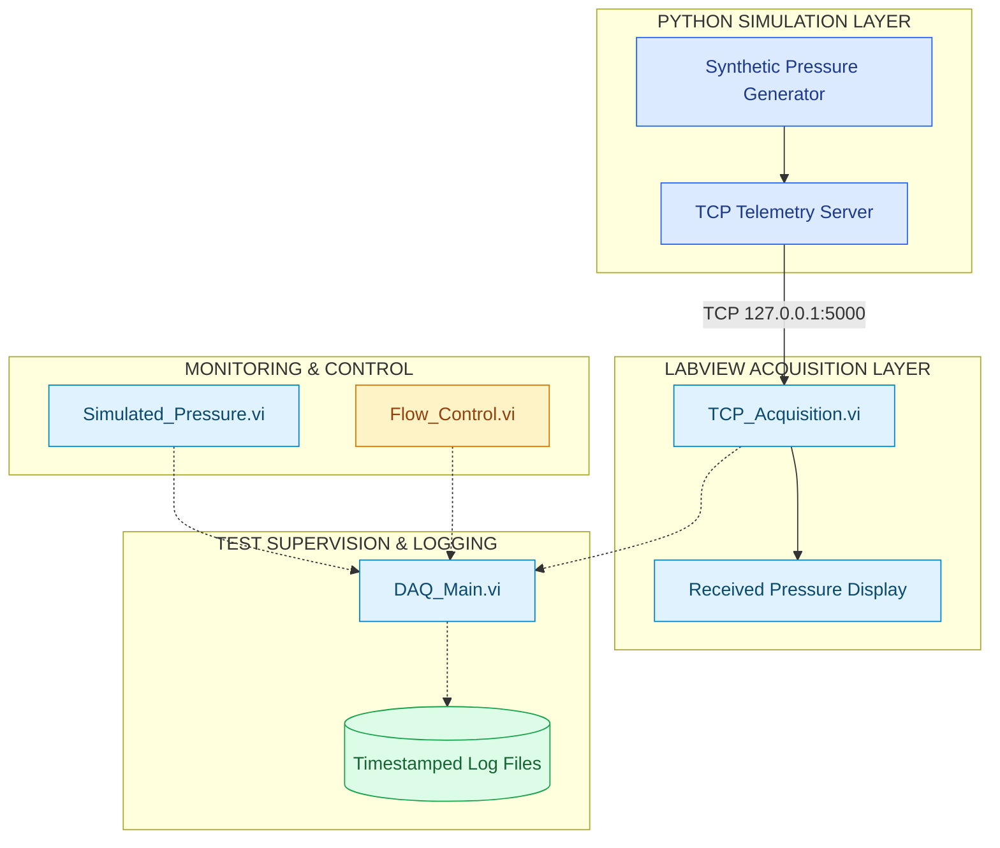

# liquid-rocket-hotfire-daq-sim

**A modular LabVIEW–Python framework for simulated liquid rocket engine ground-test data acquisition, telemetry monitoring, flow-control logic, and data logging.**

## Overview

`liquid-rocket-hotfire-daq-sim` is a software-based engineering framework exploring Data Acquisition (DAQ) and supervisory monitoring workflows for liquid rocket engine hot-fire testing.

The framework combines:

- **LabVIEW** for instrumentation interfaces, pressure visualization, TCP acquisition, simulated flow control, and data logging.
- **Python** for synthetic sensor telemetry generation and TCP communication.
- **Modular Virtual Instruments (VIs)** for acquisition, monitoring, control-state handling, and main DAQ operations.
- **Software-based validation** for nominal pressure signals, communication errors, and simulated emergency-stop conditions.

The objective is to demonstrate the fundamental architecture and engineering considerations of a ground-test DAQ system without requiring physical propulsion or instrumentation hardware.

> **Status:** Four LabVIEW VIs developed: `Simulated_Pressure.vi`, `TCP_Acquisition.vi`, `Flow_Control.vi`, and `DAQ_Main.vi`. Core simulation, TCP acquisition, and stop-control behaviors have been tested. Logging and complete system integration remain partially validated.
>
> **Scope:** Software-only engineering demonstrator. Not qualified for real propulsion-system control or hardware safety interlocks.

---

## 1. System Architecture

The framework is organized into four logical layers: telemetry generation, data acquisition, monitoring and control, and supervisory logging.

### 1.1 High-Level Design (HLD)



**Architecture interpretation**

- Solid connections represent the demonstrated Python-to-LabVIEW telemetry path.
- Dashed connections represent conceptual subsystem integration or functionality not fully verified end to end.
- Individual VIs can be tested independently.
- The current system does not implement a fully coordinated, hardware-backed acquisition sequence.

This modular approach allows individual subsystems to be developed and evaluated before full integration.

---

## 2. Framework Components

### 2.1 Synthetic Pressure Monitoring

**Virtual Instrument:** `Simulated_Pressure.vi`

Demonstrates local pressure-signal generation and monitoring using LabVIEW.

**Implemented functions:**

- Synthetic pressure generation.
- Continuous waveform visualization.
- Pressure display in bar.
- Threshold comparison.
- Boolean overpressure indication.

The observed simulation operates around **2.0–2.2 bar**.

This VI demonstrates the signal-processing and visualization concepts used in instrumentation monitoring.

It operates independently of the TCP acquisition interface.

### 2.2 TCP Telemetry Acquisition

**Virtual Instrument:** `TCP_Acquisition.vi`

Establishes communication between a Python telemetry source and LabVIEW.

**Implemented functions:**

- TCP connection to a local telemetry server.
- Reception of synthetic pressure measurements.
- Numerical pressure display.
- Basic communication-error handling.
- Acquisition loop termination following communication failure.

The Python server supplies a single pressure channel over `127.0.0.1:5000`.

The nominal simulator is designed to produce samples at approximately **10 Hz**, with pressure centered near 2.1 bar.

**Current limitations:** The protocol does not include channel identifiers or source timestamps. Robust message framing, automatic reconnection, and stale-data handling remain future improvements.

### 2.3 Simulated Flow Control

**Virtual Instrument:** `Flow_Control.vi`

Demonstrates operator-stop and emergency-stop behavior using LabVIEW Boolean functions and state management.

**Implemented functions:**

- Operator-initiated stop conditions.
- Emergency-stop input.
- Boolean OR-based shutdown logic.
- Shift-register state retention.
- Latched emergency-stop behavior.
- Simulation loop termination.

The emergency-stop state remains latched during the execution cycle and resets when a new execution begins.

This demonstrates how a control system can retain a shutdown condition rather than relying solely on a momentary input.

**Scope:** The VI demonstrates simulated control logic. Physical valve actuation, mass-flow computation, mixture-ratio control, and hardware interlocks are not implemented.

### 2.4 Main DAQ and Data Logging

**Virtual Instrument:** `DAQ_Main.vi`

Introduces a centralized LabVIEW workflow for simulated telemetry monitoring and file-logging integration.

**Development scope:**

- Main VI execution structure.
- Simulated pressure generation and display.
- Monitoring interface.
- Preliminary file-handling logic.
- Run-specific timestamped logging design.

The intended logging workflow is:

```text
Start DAQ Run
      |
Generate Run Timestamp
      |
Construct Log File Path
      |
Acquire / Generate Sample
      |
Write Measurement
      |
Stop & Close File
```

This represents the logging design rather than a completely validated data-recording pipeline.

Full verification of file creation, timestamp formatting, repeated sample writes, and safe resource closure remains pending.

---

## 3. Current Implementation Status

| Component | Responsibility | Status |
|---|---|---|
| `daq_sim/tcp_server.py` | Synthetic pressure generation and TCP streaming | Implemented |
| `Simulated_Pressure.vi` | Pressure waveform and overpressure monitoring | Tested |
| `TCP_Acquisition.vi` | TCP pressure reception and error handling | Tested |
| `Flow_Control.vi` | Operator stop and emergency-stop latch | Tested |
| `DAQ_Main.vi` | Main monitoring and logging workflow | Prototype |
| Multichannel telemetry | Multiple pressure, temperature, and flow sensors | Planned |
| NI hardware acquisition | Physical or NI-simulated DAQ devices | Not implemented |
| Automated test sequencing | Coordinated system state machine | Planned |

The implementation prioritizes fundamental DAQ concepts and subsystem-level behavior over extensive hardware integration.

---

## 4. Running the Simulator

### Prerequisites

- LabVIEW 2026 Community Edition or a compatible installation.
- Python 3.
- NumPy.
- Local TCP networking.

The LabVIEW VIs were developed on macOS.

### 4.1 Start Python Telemetry

From the repository root:

```bash
python3 -m venv .venv
source .venv/bin/activate

python -m pip install numpy
python daq_sim/tcp_server.py
```

The Python server provides synthetic pressure telemetry using:

```text
Host:       127.0.0.1
Port:       5000
Transport:  TCP
Frame Size: 16 bytes
```

### 4.2 Start LabVIEW Acquisition

1. Launch LabVIEW.
2. Open `TCP_Acquisition.vi`.
3. Verify the host and port.
4. Run the VI after starting the Python TCP server.
5. Observe incoming pressure measurements.
6. Stop the acquisition loop after testing.

### 4.3 Test Other VIs

- Open `Simulated_Pressure.vi` to observe pressure generation and overpressure indication.
- Open `Flow_Control.vi` to test stop inputs and emergency-stop state retention.
- Open `DAQ_Main.vi` to examine the central monitoring and preliminary logging workflow.

These tests are performed at the component level. Automatic execution of all four VIs as one coordinated system is not currently demonstrated.

---

## 5. Testing & Verification

The current prototype was evaluated through manual functional testing.

| Test ID | Test Scenario | Observation |
|---|---|---|
| T01 | Nominal pressure simulation | Pressure fluctuates around 2.0–2.2 bar |
| T02 | Waveform visualization | Pressure chart updates during execution |
| T03 | TCP telemetry reception | Pressure values received and displayed |
| T04 | TCP communication failure | Communication error observed; loop terminates |
| T05 | Operator stop | Simulation loop terminates |
| T06 | Emergency-stop condition | Stop state is latched during execution |
| T07 | Restart after shutdown | Latched state returns to initial condition |
| T08 | Main pressure generation | Basic simulated pressure behavior tested |
| T09 | Timestamped file logging | Complete output-file verification pending |
| T10 | End-to-end VI integration | Not yet validated |

These results represent software-level observations, not formal instrumentation acceptance testing.

---

## 6. DAQ Scalability & Engineering Considerations

The broader engineering exercise considers an instrumentation system with the following design targets:

| I/O Category | Design Target |
|---|---:|
| Slow analog inputs | 50 channels at 1 kHz |
| Fast analog inputs | 25 channels at 50 kHz |
| Digital inputs | 30 |
| Digital outputs | 30 |
| Analog outputs | 2 |

These targets are used to reason about instrumentation architecture, throughput, buffering, channel grouping, and hardware selection.

They are **not implemented capabilities** of the current software prototype.

### 6.1 Acquisition Throughput

For a representative 16-bit acquisition system:

\[
R = N \times f_s \times B
\]

Where:

- \(N\) = number of acquisition channels.
- \(f_s\) = sampling frequency.
- \(B\) = bytes per sample.

For the slow analog group:

\[
50 \times 1000 \times 2 = 100{,}000\ \text{bytes/s}
\]

For the fast analog group:

\[
25 \times 50{,}000 \times 2 = 2{,}500{,}000\ \text{bytes/s}
\]

The combined theoretical raw analog data rate is approximately **2.6 MB/s**, excluding timestamps, metadata, digital channels, transport overhead, and storage-format overhead.

A production DAQ design would require appropriate buffering, independent sampling clocks where necessary, acquisition synchronization, and sustained logging performance.

### 6.2 Engineering Tradeoffs

**Sampling:** Low-rate supervisory measurements and high-rate dynamic measurements have different timing and bandwidth requirements.

**Communication:** TCP offers reliable ordered transport but does not itself guarantee deterministic acquisition timing.

**Logging:** Buffered recording is preferable to uncontrolled file operations inside time-sensitive acquisition loops.

**Control:** Operator-facing monitoring should be separated from independent hardware-level safety mechanisms.

**Scalability:** Multichannel data structures and modular acquisition interfaces would simplify expansion beyond the current single-pressure-channel prototype.

---

## 7. Repository Structure

```text
liquid-rocket-hotfire-daq-sim/
|
|-- README.md
|-- .gitignore
|
|-- Simulated_Pressure.vi
|-- TCP_Acquisition.vi
|-- Flow_Control.vi
|-- DAQ_Main.vi
|
|-- daq_sim/
|   `-- tcp_server.py
|
`-- docs/
    |-- ARCHITECTURE.md
    `-- REQUIREMENTS.md
```

The four LabVIEW VIs remain at the repository root for straightforward review.

---

## 8. Development Roadmap

### Phase 1 — Acquisition and Monitoring

- Develop synthetic pressure telemetry.
- Establish Python-to-LabVIEW TCP communication.
- Visualize incoming signals.
- Demonstrate basic error handling.

**Status:** Initial implementation tested.

### Phase 2 — Simulated Control Logic

- Implement operator-stop behavior.
- Add emergency-stop input.
- Maintain a latched shutdown state.

**Status:** Basic Boolean control functionality tested.

### Phase 3 — Central DAQ and Logging

- Develop the main monitoring VI.
- Add run-specific file naming.
- Record telemetry with timestamps.
- Validate file contents and resource cleanup.

**Status:** Initial implementation; complete logging validation pending.

### Phase 4 — System Integration

- Coordinate acquisition, monitoring, control and logging.
- Introduce multiple telemetry channels.
- Implement explicit test states.
- Add configurable faults and alarms.

**Status:** Planned.

### Phase 5 — Hardware and Formal Validation

- Evaluate NI-compatible acquisition hardware.
- Define sensor calibration and signal conditioning.
- Validate timing, synchronization, and buffering.
- Execute repeatable fault-injection tests.

**Status:** Future engineering work.

---

## 9. Scope & Safety

This project is intended to demonstrate software architecture and fundamental engineering concepts relevant to ground-test instrumentation.

The current implementation does not provide:

- Validated NI-DAQmx hardware acquisition.
- Real-time deterministic control.
- Physical valve actuation.
- Hardware-qualified pressure or flow measurements.
- Independent safety interlocks.
- Certified shutdown mechanisms.

All pressure signals and control responses are simulated.

**This framework must not be used to control real rocket engines or hazardous equipment without separately engineered, independently validated hardware and safety systems.**

---

## 10. Conclusion

`liquid-rocket-hotfire-daq-sim` demonstrates a modular approach to LabVIEW-based data acquisition and supervisory monitoring through four Virtual Instruments and a Python telemetry source.

The implementation covers synthetic pressure generation, TCP data reception, waveform visualization, communication-error handling, simulated emergency-stop logic and preliminary main DAQ logging.

While full system integration and hardware validation remain future work, the prototype establishes a foundation for discussing DAQ architecture, signal acquisition, fault handling, control-state management, data recording, and instrumentation scalability.

---

**Project:** Data Acquisition Assignment — Hathor Rockets  
**Author:** Aniruddha Prabhash Chakravarty  
**Domain:** Liquid Rocket Propulsion | Ground-Test Instrumentation | DAQ Simulation  
**Technologies:** LabVIEW 2026, Python, NumPy, TCP/IP  
**Status:** Four-VI Software Prototype
