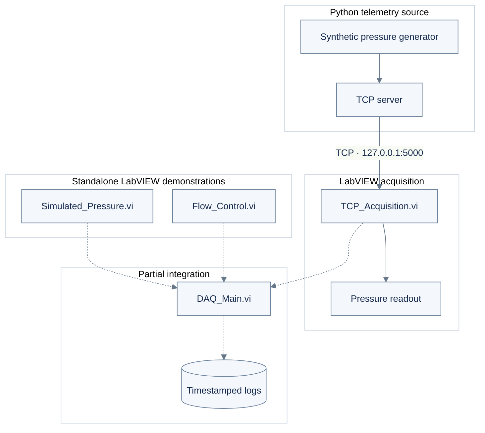

# liquid-rocket-hotfire-daq-sim

**A modular LabVIEW–Python framework for simulated Liquid-Propellant Rocket Engine (LPRE) hot-fire test data acquisition, telemetry monitoring, supervisory control, & logging.**

## Overview

`liquid-rocket-hotfire-daq-sim` explores a software-based **Data Acquisition (DAQ) and supervisory-control system** for ground-based **Liquid-Propellant Rocket Engine (LPRE)** hot-fire testing.

The framework combines:

- **LabVIEW:** Pressure visualization, TCP acquisition, simulated flow control, and telemetry logging.
- **Python:** Synthetic pressure telemetry generation and TCP communication.
- **Four Virtual Instruments (VIs):** Modular pressure simulation, acquisition, flow-control logic, and main DAQ operations.
- **Software Validation:** Nominal pressure monitoring, communication-error handling, and simulated emergency-stop conditions.

The objective is to demonstrate core LPRE ground-test instrumentation, telemetry acquisition, and monitoring workflows without physical rocket-engine hardware.

> **Status:** Four LabVIEW VIs developed: `Simulated_Pressure.vi`, `TCP_Acquisition.vi`, `Flow_Control.vi`, and `DAQ_Main.vi`. Core simulation, TCP acquisition, and stop-control behaviors tested. Logging and complete system integration remain partially validated.
>
> **Scope:** Software-only LPRE ground-test demonstrator. Not qualified for physical propulsion control or safety-critical operations.

---

## 1. Liquid-Propellant Rocket Engine (LPRE): Overview


*Figure 1. Generic liquid-propellant rocket engine (LPRE) schematic illustrating the propellant tanks, pumps, combustion chamber, and exhaust nozzle. Source: [NASA Glenn Research Center — Liquid Rocket Engine](https://www1.grc.nasa.gov/beginners-guide-to-aeronautics/liquid-rocket-engine/).*

A **Liquid-Propellant Rocket Engine (LPRE)** generates thrust by delivering liquid fuel and oxidizer into a combustion chamber, where combustion produces high-temperature, high-pressure gases that expand through an exhaust nozzle.

As illustrated in **Figure 1**, a pump-fed LPRE uses separate fuel and oxidizer tanks, turbopumps, propellant-feed lines, and a combustion chamber. The pumps raise propellant pressure to enable injection into the chamber, while the nozzle accelerates the combustion gases to generate thrust. Pressure and flow conditions throughout the feed system directly influence engine performance and operational stability.

During **ground-based LPRE hot-fire testing**, a Data Acquisition (DAQ) system monitors critical parameters, including combustion-chamber pressure, pump discharge pressure, fuel and oxidizer feed-line pressures, temperature, and propellant flow rates. Continuous telemetry helps engineers evaluate engine performance, identify abnormal operating conditions, and support test safety.

The proposed **High-Level Design (HLD)** models a software-based DAQ and supervisory-control architecture for this LPRE testing environment. It integrates **Python-generated synthetic pressure telemetry, TCP communication, and LabVIEW Virtual Instruments (VIs)** to demonstrate real-time acquisition, pressure visualization, threshold monitoring, communication-error handling, simulated emergency-stop logic, and a preliminary telemetry-logging workflow.

The implementation is a **software-only LPRE hot-fire DAQ demonstrator**. Although the physical architecture in Figure 1 provides the engineering context, the current simulation does not model actual turbopump dynamics, propellant combustion, or fluid flow, nor does it interface with physical sensors, propulsion hardware, or safety-critical control systems.

---

## 2. System Architecture



**Figure 1.** System-level architecture. Solid lines denote the tested TCP telemetry path; dashed lines denote unvalidated integration or logging paths. The pressure and flow-control VIs are independently operated.

## 3. Implementation Status

| Component | Demonstrated function | Status |
|:--|:--|:--|
| `daq_sim/tcp_server.py` | Synthetic pressure streaming over TCP | Implemented |
| `Simulated_Pressure.vi` | Pressure chart and threshold-based alarm | Tested |
| `TCP_Acquisition.vi` | Pressure readout and basic connection-error handling | Tested |
| `Flow_Control.vi` | Operator stop and latched emergency-stop logic | Tested |
| `DAQ_Main.vi` | Main monitoring and timestamped logging design | Partial; full logging unverified |

The demonstrated pressure signal is approximately **2.0–2.2 bar**. The Python source nominally transmits at **10 Hz**. Multichannel acquisition, synchronized test sequencing, and physical NI-DAQ hardware are outside the implemented scope.

## 4. LabVIEW Implementation Evidence

### 4.1 Simulated Pressure

Generates a local synthetic pressure waveform, displays it continuously, and evaluates an overpressure threshold.


*Figure 2. Simulated Pressure — front panel showing the pressure chart and overpressure indicator.*


*Figure 3. Simulated Pressure — LabVIEW signal generation and threshold-comparison logic.*

### 4.2 TCP Acquisition

Receives pressure samples from the Python server on `127.0.0.1:5000`. Basic error handling terminates acquisition on a communication fault.


*Figure 4. TCP Acquisition — live received-pressure display.*


*Figure 5. TCP Acquisition — connection, read loop, error handling, and cleanup.*


*Figure 6. Python telemetry server — terminal output from the acquisition test.*

### 4.3 Flow Control and Emergency Stop

Implements simulated operator-stop logic and a retained emergency-stop state during execution. No physical valves are actuated.


*Figure 7. Flow Control — operator interface under normal simulation conditions.*


*Figure 8. Flow Control — emergency-stop demonstration.*


*Figure 9. Flow Control — Boolean shutdown logic and state retention.*

### 4.4 Main DAQ Prototype

`DAQ_Main.vi` contains preliminary monitoring and file-handling logic. File creation, repeated timestamped writes, and complete integration have **not** been verified.


*Figure 10. DAQ Main — partial integration and logging block diagram.*

## 5. Acquisition Capacity Estimate

The following values are **design targets**, not measured prototype capacity.

| I/O group | Channels | Sample rate |
|:--|--:|--:|
| Slow analog inputs | 50 | 1 kHz |
| Fast analog inputs | 25 | 50 kHz |
| Digital inputs | 30 | — |
| Digital outputs | 30 | — |
| Analog outputs | 2 | — |

For 16-bit analog samples, the theoretical uncompressed throughput is

$$
R = N f_s B
$$

where $N$ is the channel count, $f_s$ is the sample rate in samples/s, and $B=2\ \mathrm{bytes/sample}$.

**Slow analog channels:**

$$
R_{\mathrm{slow}} = 50(1{,}000)(2) = 100{,}000\ \mathrm{bytes/s}
$$

**Fast analog channels:**

$$
R_{\mathrm{fast}} = 25(50{,}000)(2) = 2{,}500{,}000\ \mathrm{bytes/s}
$$

**Total raw analog throughput:**

$$
\boxed{R_{\mathrm{total}} = 2.6\ \mathrm{MB/s}}
$$

This estimate excludes metadata, timestamps, digital I/O, protocol overhead, and storage overhead. Practical deployment would require appropriate buffering, timing synchronization, and sustained-write validation.

## 5. Reproduce the Demonstration

**Requirements:** Python 3, NumPy, LabVIEW 2026 Community Edition (or compatible), and local TCP access.

From the repository root:

```bash
python3 -m venv .venv
source .venv/bin/activate
python -m pip install -r requirements.txt
python daq_sim/tcp_server.py
```

Then open `TCP_Acquisition.vi` in LabVIEW and run it with the server active. `Simulated_Pressure.vi` and `Flow_Control.vi` can be tested separately.

## 7. Validation Summary

| Test | Observation |
|:--|:--|
| Local pressure simulation | Pressure chart varies near 2.0–2.2 bar |
| TCP reception | Incoming pressure displayed in LabVIEW |
| TCP failure | Connection error observed; acquisition stops |
| Operator / emergency stop | Simulation terminates; emergency state latches during the run |
| Restart | Latched state resets on new execution |
| Timestamped logging | **Not fully verified** |
| End-to-end four-VI integration | **Not verified** |

These are manual software-level checks, not calibrated measurements or hardware acceptance tests.

## 8. Scope

The prototype does **not** implement NI-DAQmx device acquisition, deterministic control, physical valve actuation, independent safety interlocks, or a qualified hot-fire test system.


---

## 9. Conclusion

liquid-rocket-hotfire-daq-sim demonstrates a modular LabVIEW-based Data Acquisition (DAQ) and supervisory-monitoring framework for a simulated Liquid-Propellant Rocket Engine (LPRE) hot-fire test, integrating four Virtual Instruments (VIs) with a Python-based telemetry source.

The implementation covers synthetic pressure generation, TCP-based telemetry acquisition, real-time waveform visualization, communication-error handling, simulated emergency-stop logic, and preliminary DAQ telemetry logging.


---
